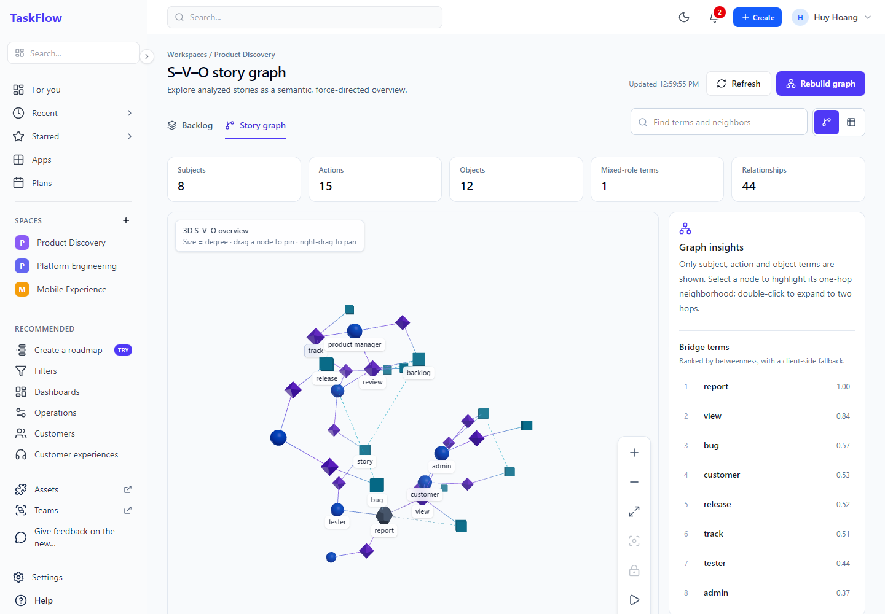
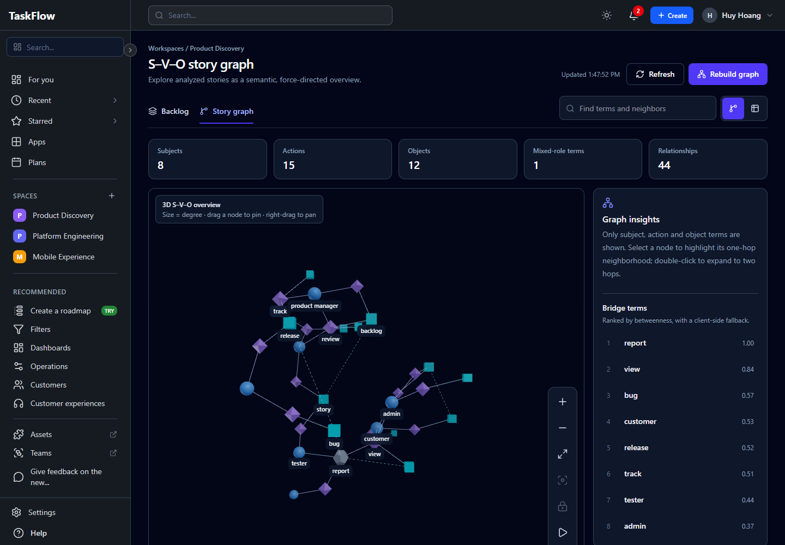
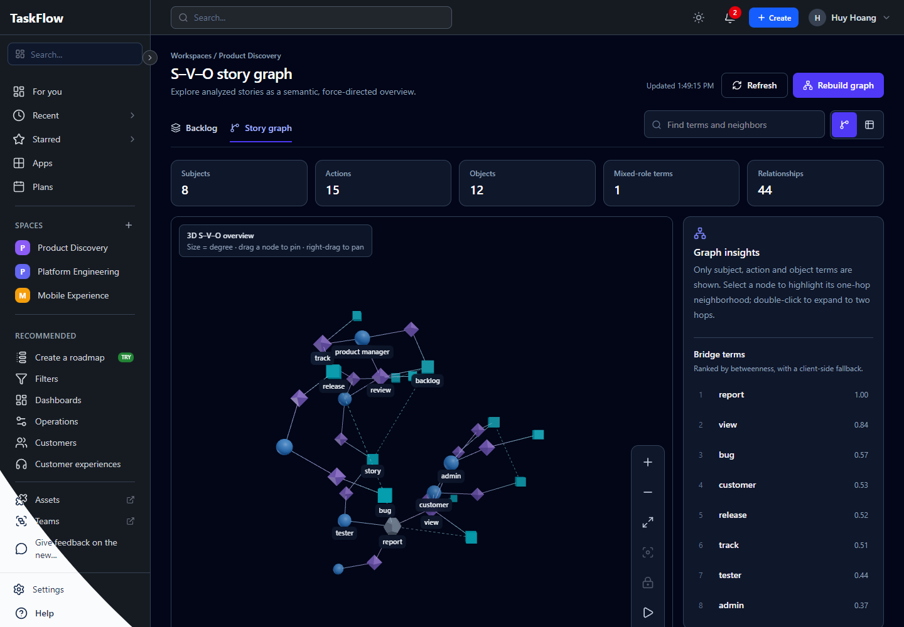
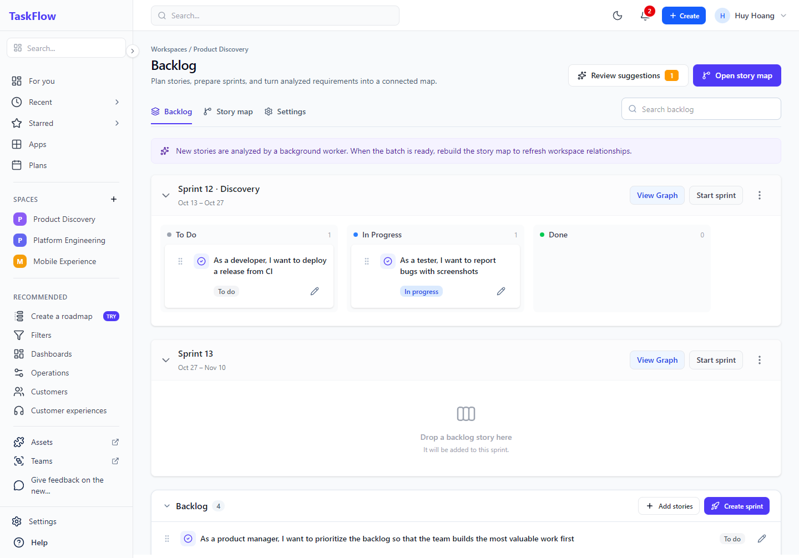
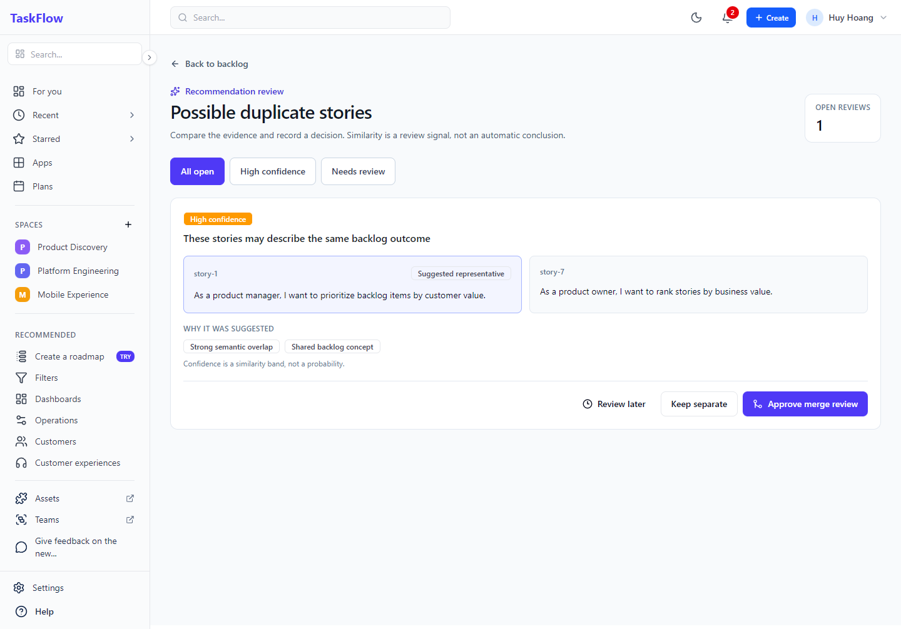
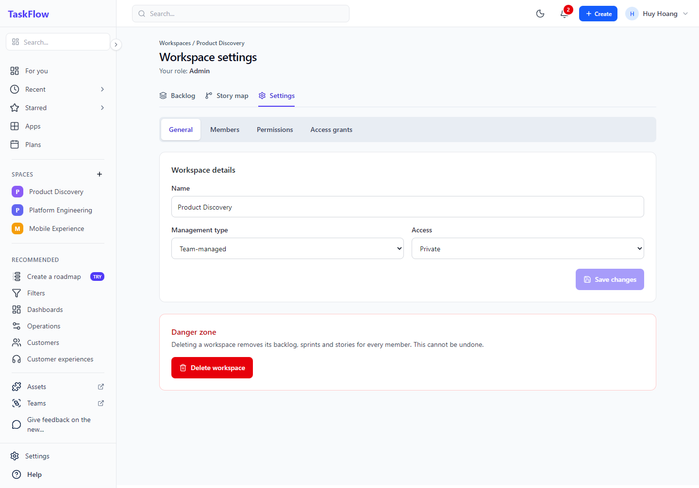
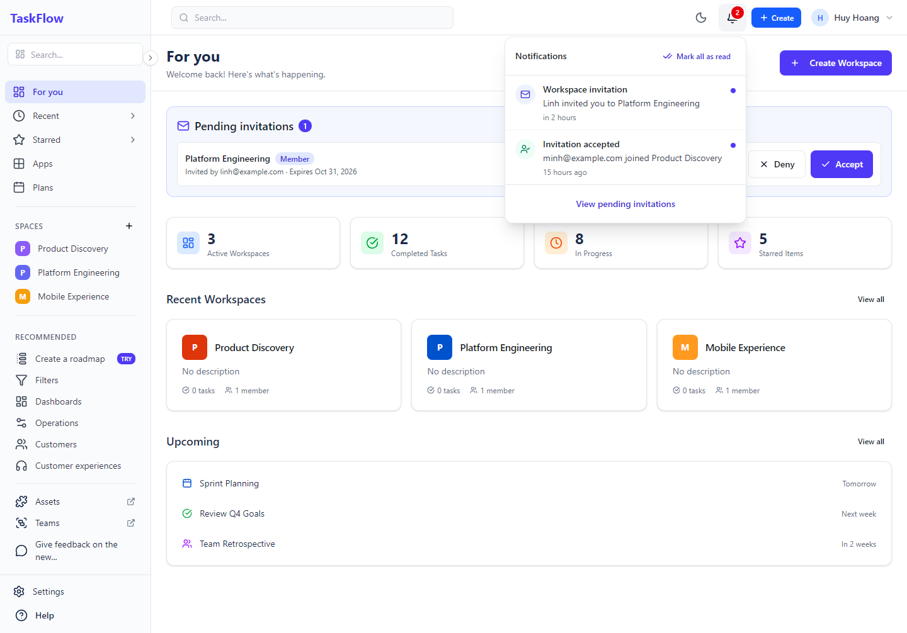
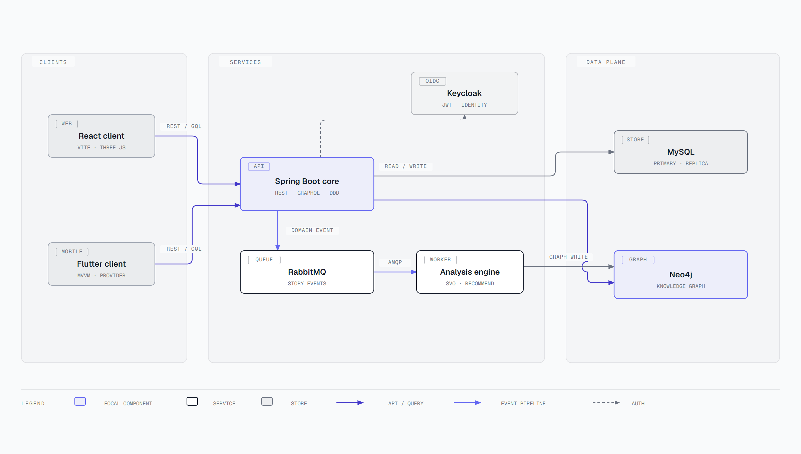

# TaskFlow

> An open research prototype for planning Agile work, uncovering relationships between user stories, and reviewing evidence-backed recommendations as a team.


TaskFlow combines familiar workspace, backlog, and sprint workflows with a knowledge graph built from user-story language. Teams can organize delivery work, explore subject–verb–object relationships in an interactive 3D graph, and review possible duplicate stories without letting automation silently change the backlog.

This repository is under active development. It is a good fit for contributors interested in Agile tooling, domain-driven design, graph visualization, event-driven systems, or applied NLP.

## Product tour



<table>
  <tr>
    <td width="50%"></td>
    <td width="50%"></td>
  </tr>
  <tr>
    <td align="center"><strong>3D S–V–O graph · dark theme</strong></td>
    <td align="center"><strong>Animated light/dark switch</strong></td>
  </tr>
  <tr>
    <td width="50%"></td>
    <td width="50%"></td>
  </tr>
  <tr>
    <td align="center"><strong>Backlog and sprints</strong></td>
    <td align="center"><strong>Human-in-the-loop recommendations</strong></td>
  </tr>
  <tr>
    <td width="50%"></td>
    <td width="50%"></td>
  </tr>
  <tr>
    <td align="center"><strong>Workspace settings, roles, and ACL</strong></td>
    <td align="center"><strong>Notifications and invitations</strong></td>
  </tr>
</table>

<sub>Captured from the real React client with deterministic API fixtures. Every page is available in light and dark theme in <a href="fe_web/react-web/docs/img"><code>fe_web/react-web/docs/img</code></a>. To refresh them, run <code>npm run dev</code> and then <code>npm run screenshots</code> from <code>fe_web/react-web</code> (Playwright Chromium; install it once with <code>npx playwright install chromium</code>).</sub>

## Why TaskFlow?

- **Plan together**: create workspaces, invite members, manage backlogs, and run sprints with start and end dates.
- **See hidden relationships**: turn user stories into an interactive 3D knowledge graph. It shows only subject, action, and object terms, so it stays readable.
- **Review, do not blindly automate**: compare duplicate-story evidence and explicitly merge, separate, or defer each recommendation.
- **Edit safely together**: story edits use optimistic locking, so a concurrent change is reported instead of being silently overwritten.
- **Keep analysis off the request path**: publish story and rebuild events through RabbitMQ, process them asynchronously, and follow the rebuild job's progress in the UI.
- **Model access explicitly**: combine workspace roles, an editable role–permission matrix, and resource-level grants.
- **Comfortable to use**: light and dark themes with an animated switch, unread notifications, and keyboard-accessible table views.
- **Build on multiple clients**: use the React web app or the Flutter client against the same API.

## Architecture at a glance

The main request path runs through the modular Spring Boot API. User-story changes are persisted in MySQL and published to RabbitMQ. The Python workers then parse each story into subject–verb–object terms, write them to Neo4j with role labels, and produce duplicate-story candidates. Clients query the resulting graph through GraphQL and review recommendations through REST.



[Open the full architecture diagram](docs/architecture-overview.html). It is a self-contained, accessible HTML/SVG document that can be viewed locally in any modern browser.

| Area | Technology | Responsibility |
| --- | --- | --- |
| Web client | React 19, TypeScript, Vite, Tailwind CSS 4, React Three Fiber + d3-force-3d | Workspace UI, sprint/backlog flows, recommendation review, 3D graph exploration |
| Cross-platform client | Flutter, Provider/MVVM | Mobile and desktop client experiments |
| Core API | Java 21, Spring Boot, Maven, Flyway | REST/GraphQL APIs, domain rules, authorization, events, background jobs |
| Identity | Keycloak, OAuth 2.0/OIDC | Authentication and JWT issuance |
| Operational data | MySQL primary/replica, Redis | Transactional storage, read routing, and caching |
| Knowledge graph | Neo4j + Graph Data Science | Story terms (`:Term:Subject/:Action/:Object`), relationships, centrality metrics |
| Analysis pipeline | FastAPI, spaCy, Gensim | Parsing, semantic normalization, duplicate candidates, and graph construction |
| Messaging | RabbitMQ | Story created/moved events, graph rebuild requests, recommendation job status |

The backend follows a modular DDD-style dependency direction:

```text
nckh-controller → nckh-application → nckh-domain
        │                 ↑
        └──── nckh-infrastructure ──── external systems
```

## Repository map

```text
taskflow/
├── be/nckh/                 # Multi-module Spring Boot backend
├── fe_web/react-web/        # Primary React web client (docs/ has graph docs and screenshots)
├── analyze_user_stories/    # Python NLP and knowledge-graph workers
├── docker-compose/          # Local infrastructure: MySQL, Keycloak, Neo4j, Redis, RabbitMQ
├── frontend-mvvm/           # Flutter MVVM client
├── frontend/                # Earlier Flutter client
└── docs/                    # Architecture diagram and supporting documentation
```

## Quick start

TaskFlow is a distributed development stack. For the shortest first contribution, run and test the component you plan to change. The React client can run against mocked data (see [Testing](#testing)); a full local environment needs the Docker services, Keycloak, the backend, and the analysis workers.

### 1. Clone the repository

```bash
git clone https://github.com/DucHuy74/taskflow.git
cd taskflow
```

### 2. Start local infrastructure

All infrastructure services are defined in one Compose file:

```bash
cd docker-compose
cp env.example .env        # then replace every change-me value
docker compose up -d
```

| Service | Host port | Notes |
| --- | --- | --- |
| MySQL primary / replica | 3307 / 3308 | Backend database `nckh` (writes go to the primary, reads to the replica) |
| MySQL `analyze_us` | 3306 | Analysis results |
| Keycloak | 8180 | Admin console at `http://localhost:8180` |
| Neo4j | 7474 (browser), 7687 (bolt) | Graph Data Science plugin enabled |
| Redis | 6379 | |
| RabbitMQ | 5672, 15672 (management UI) | |

> Several volumes are declared as `external` so that data from earlier per-service setups is reused. On a fresh machine, create them once before `up`:
> `docker volume create analyze_us_db_analyze_us_mysql_data`, and likewise `neo4j_neo4j_data`, `neo4j_neo4j_logs`, `neo4j_neo4j_plugins`, `redis_redis_data`, and `taskflow_keycloak_data`.
>
> The analysis workers currently connect to RabbitMQ as `guest`/`guest`. Keep those credentials locally, or update the worker configuration. Compose credentials are development defaults only; replace them before using TaskFlow outside a local machine.

In Keycloak, create the `nckh` realm and an `nckh_app` client with your local redirect URLs. Give the client's service account the `realm-management` → `manage-users` role, which registration and profile updates use. The repository does not ship a realm export yet, so this step is manual.

### 3. Run the backend

Requirements: **JDK 21 or newer** (set `JAVA_HOME` accordingly) and Maven 3.9+.

The backend reads its configuration from `be/nckh/.env`. Create that file locally and provide the variables referenced by [`application.yml`](be/nckh/nckh-start/src/main/resources/application.yml), including the MySQL primary/replica, Redis, RabbitMQ, Neo4j, mail, and Keycloak settings.

```bash
cd be/nckh
mvn test
mvn -pl nckh-start -am spring-boot:run
```

Flyway applies the schema migrations on startup. With `SERVER_PORT=8080` and `SERVER_CONTEXT_PATH=/api`:

- the REST API is available at `http://localhost:8080/api`
- GraphQL is available at `http://localhost:8080/api/graphql`

Every request needs an `x-api-key` header; the backend prints the key on its first start. Successful responses use the `{ "code": 1000, "result": … }` envelope.

### 4. Run the analysis workers

The Python workers are needed for NLP enrichment and knowledge-graph updates, but not for every frontend or domain contribution. They expect Python 3, MySQL, Neo4j, RabbitMQ, and a local word-vector model configured through `analyze_user_stories/.env`.

```bash
cd analyze_user_stories
python -m venv venv
source venv/bin/activate          # Windows: venv\Scripts\activate
pip install -r requirements.txt
```

Run each process in its own terminal:

```bash
python -m src.messaging.consumer      # realtime: analyzes created/moved stories
python -m src.messaging.batch_runner  # "Rebuild graph": similarity, association rules, priority, duplicates
uvicorn main:app --reload             # optional HTTP API (/analyze)
```

If your Neo4j database already contains terms written before role labels existed, label them once:

```bash
python scripts/backfill_term_role_labels.py --dry-run   # preview counts per workspace
python scripts/backfill_term_role_labels.py
```

Large NLP model files are intentionally not stored in Git. Configure or download the required model locally before starting the workers.

### 5. Start the React client

Requirements: Node.js 22.12+ and npm.

```bash
cd fe_web/react-web
cp .env.example .env    # API URL, Keycloak realm/client, client secret, x-api-key
npm install
npm run dev
```

The app is served at `http://localhost:5173`. By default it expects the API at `http://localhost:8080/api` and Keycloak at `http://localhost:8180`.

Useful frontend commands:

```bash
npm run build        # Type-check and create a production build
npm run lint         # Run Oxlint
npm run test:run     # Run unit tests once
npm run screenshots  # Refresh docs/img (dev server must be running)
npx playwright test  # Run end-to-end tests
```

## Core workflows

1. A user signs in through Keycloak and opens a workspace.
2. The client manages workspace members, roles, backlog items, and sprints through REST endpoints.
3. The backend persists transactional data and emits domain events after a successful commit.
4. The realtime worker consumes story events, extracts subject–verb–object triples, and writes labelled terms and `PERFORM`/`TARGET` relations to Neo4j.
5. **Rebuild graph** queues a job. The batch worker adds `SIMILAR` and `ASSOCIATED` relations, centrality metrics, and duplicate-story candidates, while the client shows the job's progress.
6. The client requests the graph through GraphQL and renders only the subject, action, and object terms as a 3D force-directed graph. See [`fe_web/react-web/docs/story_graph_3d.md`](fe_web/react-web/docs/story_graph_3d.md).
7. Reviewers inspect evidence and record a merge-review, keep-separate, or defer decision; TaskFlow does not mutate stories automatically.

## Testing

Run checks close to the code you changed:

```bash
# Java unit and integration tests (integration tests use Testcontainers, so Docker must be running)
cd be/nckh && mvn test

# React unit tests and production build
cd fe_web/react-web && npm run test:run && npm run build

# Python tests
cd analyze_user_stories && python -m unittest discover -s tests -t .

# Flutter tests
cd frontend-mvvm && flutter test
```

End-to-end tests in `fe_web/react-web/tests/e2e` mock the API, so they only need the Vite dev server.

## Documentation

- [Architecture diagram](docs/architecture-overview.html)
- [3D story graph: data flow, GraphQL contract, interactions, and reuse guide](fe_web/react-web/docs/story_graph_3d.md)
- [Screenshots of every page in light and dark theme](fe_web/react-web/docs/img)

## Contributing

Contributions are welcome. A focused pull request is the easiest to review:

1. Fork the repository and branch from `main`.
2. Keep changes inside one bounded concern when possible.
3. Add or update tests for behavior changes.
4. Run the relevant formatter, tests, and build locally.
5. Explain the user impact and any setup changes in the pull request.

Good first contribution areas include setup automation, a reproducible Keycloak realm export, environment templates for the backend and analysis workers, API documentation, test coverage, accessibility, and graph-visualization improvements.

## Project status

TaskFlow is an active academic/research project rather than a production-ready hosted service. APIs, local setup, and data models may still change. Issues and pull requests that improve reproducibility and developer experience are especially valuable.

---

Built for teams who want to understand the work behind the board, not only move cards across it.
